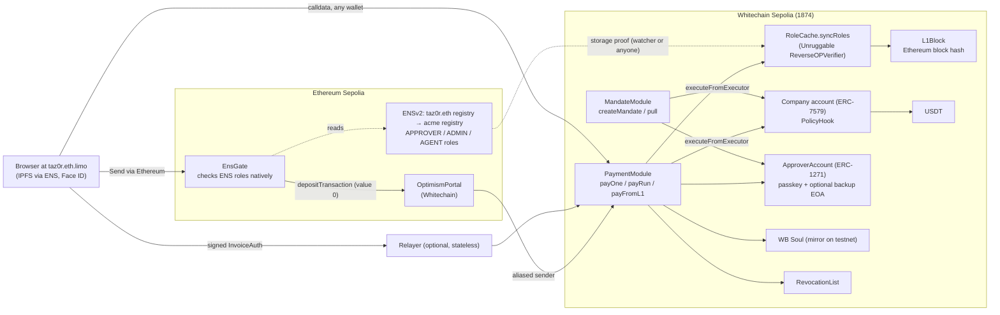

# Tazor

**Get a business paid in USDT on Whitechain, from checkout to refund to financing. The payer never needs WBT, a seed phrase or to know which chain they're on.**

Built at ETHGlobal Mumbai (November 2026) for **Whitechain**: Operate, with Scale and Tokenize underneath.

| | What a business gets | Whitechain feature it rests on |
|---|---|---|
| **Checkout** | A 15-line drop-in pay button. The customer signs **one message** in any wallet (no gas, no WBT), or **pays from WhiteBIT or any exchange** with a plain transfer to the order's own deposit address | The track USDT's EIP-3009 `receiveWithAuthorization` (bytes signatures, so ERC-1271 works) and CREATE2 deposit addresses |
| **After the sale** | One-click **refunds** that can only reach the original payer and never exceed what was paid. **Subscriptions** with permit-based pulls that can't run early, can't exceed the plan, and can be cancelled anytime. **HMAC-signed webhooks.** An **on-chain receipt** that tracks Whitechain's three finality stages. **Accountant export** | EIP-2612 `permit` on the track USDT; OP Stack `safe` / `finalized` heads |
| **AI agents** | **x402 pay-per-request:** an agent holding only USDT pays an API through a facilitator we run, under a hard spend cap | EIP-3009 `transferWithAuthorization` |
| **B2B invoicing** | Invoices, payment runs and direct-debit mandates, approved by **WhiteBIT-verified people** (WB Soul) with Face ID or fingerprint passkeys | P-256 precompile, WB Soul |
| **Tokenize** | An approved invoice becomes a claim only verified holders can own. It's **sold at a discount** and **settled at maturity** in USDT | Transfer rules in the contract, WB Soul allowlist |
| **Can't be switched off** | If our servers go away, or the sequencer refuses a payment, the signed payment still goes through Ethereum (OptimismPortal) | OP Stack forced inclusion |

**Why on-chain USDT on Whitechain, not a card or bank rail:** the customer authorises an exact amount to an exact merchant with one signature, and **anyone** can settle it in about 4 s for a fraction of a cent. The refund and subscription rules are enforced by the contract that moves the money, not by a processor's goodwill. An exchange user pays from their WhiteBIT balance with no wallet at all. A card network or bank API can't offer payments that settle in seconds, can't be redirected, and still go through if the provider disappears.

**Key USDT payments** (official USDT `0xcedf…55a7`, all on Whitechain Sepolia):
- Gasless checkout via the hosted relayer: [`0xd064…a4aa`](https://explorer.testnet.whitechain.io/tx/0xd0645d4adc8c7d7aab44c1fa9a8a0a7a3a1d67271a21a623009c72977396a4aa) (4.0 s; the customer held 0 WBT)
- AI agent over x402: [`0xd198…b2ea`](https://explorer.testnet.whitechain.io/tx/0xd198ce094200b4c1b75120d1652d3e4cd1b9d5f3cda9828b4d4916dd76a1b2ea)
- Paid from an exchange-style transfer: [`0x91bb…c0`](https://explorer.testnet.whitechain.io/tx/0x91bb2ba4fa685641b222edb0ecd64724291e5eccd405110d2b122265961dd4c0)
- B2B invoice approved by verified people: [`0xbcee…4f21`](https://explorer.testnet.whitechain.io/tx/0xbceeaa443a3e17a19037a677a459a88dcd11a7e17b01ebd431118c997ce84f21)

**Try it (testnet only, no real money):**
- **Merchant demo:** https://bluejay-shop.vercel.app, a separate shop with Tazor added in 15 lines. The customer view and the merchant view sit side by side: orders, refunds, subscriptions, webhooks and CSV.
- **App:** https://tazor-app.vercel.app. It has receipts, the merchant Checkout console, B2B invoicing, approvals, mandates and financing. The **Autopilot** (`/autopilot/`) runs every feature on the real pages.
- **AI agent:** `AGENT_KEY=… node --experimental-strip-types examples/agent/agent.ts`
- **Relayer and x402 facilitator:** https://tazor-relayer.vercel.app/health (optional; anyone can submit the same signed payments).

## Checkout on Whitechain: live

Contracts: [`TazorCheckout`](https://explorer.testnet.whitechain.io/address/0x8Ce727e6B4099b68f667B1ffEcAd7e1BeB511670) and [`TazorDepositCheckout`](https://explorer.testnet.whitechain.io/address/0xcb3515398C8Cd9459a1Dce75aB42ec664a07B3ab), both verified. Twenty fork tests run against the real Whitechain Sepolia USDT, including the attack cases: a redirected signature, a changed amount, double pay, an over-refund, a forged refund, a stranger cancelling, and changed plan terms.

| Flow | Transactions | Notes |
|---|---|---|
| Pay with one signature (direct) | [`0xa460…880c`](https://explorer.testnet.whitechain.io/tx/0xa460e8e3039db8c9d1e7ee2b94872e659d348fa8372a9c56d7d67784a82d880c) | new payer with 0 WBT |
| Partial refund, signed by the merchant | [`0xff03…bb19`](https://explorer.testnet.whitechain.io/tx/0xff03d2f10023137aaf91ccce903524c3cbaa573cd8dc097fad6ac1f690a1bb19) | the money can only go to the original payer |
| Subscribe (cycle 1 + permit) → pull cycle 2 → cancel by signature | [`0xd483…f1c3`](https://explorer.testnet.whitechain.io/tx/0xd48336d3cd7043f9b8f794738ec1eb55af6f56ab1323d55e4d07e36f9dddf1c3), [`0x73cc…0754`](https://explorer.testnet.whitechain.io/tx/0x73cc7660e0dee0d0a67a3e439a9fe7b2697b6e53065279fbd6404c3820620754), [`0xad59…fdd9`](https://explorer.testnet.whitechain.io/tx/0xad59a297ede3d74489e1ea5f6310c0ee22a7e23976cdeabb8cbebddbb604fdd9) | a charge after the cancel reverts |
| Hosted: pay → refund → finality → signed webhooks | [`0xd064…a4aa`](https://explorer.testnet.whitechain.io/tx/0xd0645d4adc8c7d7aab44c1fa9a8a0a7a3a1d67271a21a623009c72977396a4aa), [`0x891a…f9a6`](https://explorer.testnet.whitechain.io/tx/0x891ab36355f28290f5cef50f80a791067d71c48c4bebfed4e16adb386d55f9a6) | `order.paid`, `order.refunded` and `order.finality` signatures all verified |
| Pay from an exchange: plain transfer with overpayment → settle | [`0xf4b8…e596`](https://explorer.testnet.whitechain.io/tx/0xf4b8e6dafefb85a3f2b39abbcd9bf8b738ca0554c72e203048606ef9f2f4e596), [`0xc177…184d`](https://explorer.testnet.whitechain.io/tx/0xc17736b36c772385624ff58bf8309591c7d2776bf0cf42415f10a5c0ca83184d) | the merchant got exactly the order amount; the extra went back in the same tx |
| Renewal with nobody clicking: hosted subscribe → cron charges cycle 2 | [`0x7eac…40f4`](https://explorer.testnet.whitechain.io/tx/0x7eace55c76d58d2670c9dca7fcde696be9d42a7fab1d6c3a1e33467d3d4f40f4), [`0x3c0b…06d1`](https://explorer.testnet.whitechain.io/tx/0x3c0b7ce52ce4cd1d817090dd5efe87ceb7ac3382776bab91d3f068b7b95406d1) | `GET /watch` charges due cycles and sends `subscription.due` reminders 24 h ahead |
| AI agent pays an API over x402 | [`0xd198…b2ea`](https://explorer.testnet.whitechain.io/tx/0xd198ce094200b4c1b75120d1652d3e4cd1b9d5f3cda9828b4d4916dd76a1b2ea) | with a 0.005 cap, the agent refuses the 0.01 price |

Reproduce: `scripts/checkout-live.ts`, `scripts/deposit-live.ts`, `scripts/hosted-checkout-live.ts`, `scripts/subscription-cron-live.ts` (receipts in `scripts/checkout-live/`).

**How the business pays gas, and what stops relayer drain (Scale):**
- The relayer holds WBT, funded by the operator (faucet on testnet; on mainnet, WBT withdrawn from WhiteBIT). `/health` shows the gas runway.
- Every write is checked before it costs gas: the signature, the payer's balance, the authorization not yet used, a validity window of at most 1 h, and an `eth_call` simulation.
- Limits per IP, per payer, per merchant and per order, plus a daily WBT budget and a balance floor. A failed check costs us nothing.
- The relayer is a convenience, not a gatekeeper: anyone can submit the same signed payment, so pausing it never strands a customer.

## B2B invoicing and approvals: live

| Flow | Transactions | Measured |
|---|---|---|
| Payment via the relayer | [`0xbcee…4f21`](https://explorer.testnet.whitechain.io/tx/0xbceeaa443a3e17a19037a677a459a88dcd11a7e17b01ebd431118c997ce84f21) | 3.6 s, 168,817 gas |
| Payment with our servers down, via Ethereum | Sepolia [`0x2e38…1019`](https://sepolia.etherscan.io/tx/0x2e387ff547f1100cc6ef5baf780acaf19a220b0b0ce7d140b7dc06e8ec561019) → Whitechain [`0xa00d…a30e`](https://explorer.testnet.whitechain.io/tx/0xa00dbd6923b79335f4ee60733adaa0f68652a47915141ddba0e6719b48eea30e) | 69 s, 465k L1 gas + 144k L2 gas |
| ENS role proven onto Whitechain | [`0xd670…a440`](https://explorer.testnet.whitechain.io/tx/0xd67061dda74f7918c4409163d669fba2034f2ab6d6be9b401a3cef9b87d9a440) | ~0.96M gas |
| Automatic role sync by the watcher | Sepolia [`0x2f3e…f85e`](https://sepolia.etherscan.io/tx/0x2f3ec2c6e08d5cb6e4b3bca91e412a75bb164d943c30efb6a7db712bada7f85e) → Whitechain [`0xddfb…7ef5`](https://explorer.testnet.whitechain.io/tx/0xddfb4170e6ab70e9c884ba394d5a12e6d3e7885ab9ad35716e6dfdd7d4747ef5) | 84 s |
| Remove an approver | [`0x027e…d6ef`](https://explorer.testnet.whitechain.io/tx/0x027e1cfd06b86adaadab600b98b9444c98178c56ff038ef09daacb3df6ecd6ef) | 3.06 s; their next payment is refused |
| Mandate (direct debit): create, then pull | create [`0x5711…2a1a`](https://explorer.testnet.whitechain.io/tx/0x57117de515ca27dd80638e20c457949e6fa7c1d5d56d6ac8970c784c54d12a1a), pull [`0x593e…10b2`](https://explorer.testnet.whitechain.io/tx/0x593e6ac94971ca40c6ee3b8c67f0064a43044ba6bfeabe88181906d4c46210b2) | pull 84,554 gas; an over-cap pull is refused |
| Credit note (an ordinary `payOne` from the supplier's company account to the buyer's) | [`0x4be6…4c38`](https://explorer.testnet.whitechain.io/tx/0x4be6a82a6f5a8aa7df415cecda37f693d2e4b09659474765fac407d9da1b4c38) | 0.3 USDT, 151,705 gas |

### v2 policy features, live (one scripted run: `scripts/demo-v2.sh`, all recorded in `scripts/demo-v2/last-run.json`)

Company `acme-p2` runs PaymentModuleV2 + MandateModuleV2 + FinancingModule. The demo uses short timings: a 120 s payee delay (production 24 h) and a 180 s exit delay (production 7 days).

| Feature | What happened | Transactions |
|---|---|---|
| New-payee delay | refused before `addPayee` + delay, paid after | [`0x7e94…a809`](https://explorer.testnet.whitechain.io/tx/0x7e94fbe9b8df9917c031ea3c38309548733d9487869000cd72221bf932baa809), [`0x44e8…2114`](https://explorer.testnet.whitechain.io/tx/0x44e89ba200aa8c00374fa6f104e6cf6476853fa23b59fb2aa6bc8b87c8712114) |
| Per-payment limit | 9 USDT over the 8 USDT limit refused | simulation |
| Fresh-proof rule | 4 USDT refused with a stale role cache, then a live re-sync, then paid | [`0x9b5d…d9e9`](https://explorer.testnet.whitechain.io/tx/0x9b5d5702159502f805da0bc050ccd3ad157ce928abde45600ca7795c6a20d9e9), [`0x8130…348a`](https://explorer.testnet.whitechain.io/tx/0x813018bd67c4096764272e0cb5a7e282bb1422f5071dd5f0f53d3fc6836e348a) |
| Provisional grant (10 min) | Meera, an EIP-7702 wallet with no ENS role, paid 0.5 USDT | [`0x8bab…5786`](https://explorer.testnet.whitechain.io/tx/0x8babc9fae8c48e331636fdd503580bb45e7a56ca170fed4fe112a5b9c5175786), [`0xd495…e661`](https://explorer.testnet.whitechain.io/tx/0xd4952b980f6ee35ae7d21e0f2c86f51935bc35e0f03e76149cdfcd5b6f21e661) |
| Agent cap | agent paid 1 USDT; 2.5 USDT over the monthly cap refused | [`0x7d66…a44a`](https://explorer.testnet.whitechain.io/tx/0x7d6652fe3e27354d45edec4f5a13a2705811bd1a7874ec67955bbc19ab34a44a) |
| Contractor expiry | CFO refused after `until`, while his ENS role stayed | [`0x5a0b…3319`](https://explorer.testnet.whitechain.io/tx/0x5a0b6efd78cc4ffc68740733e881a9fcd3b36eb6771366baddcd0479997b3319) |
| Invoice financing (Tokenize) | claim committed → sold at 1.9 USDT to a verified financier → settled at maturity for 2 USDT | [`0x54f4…1c22`](https://explorer.testnet.whitechain.io/tx/0x54f463c35c7fd525e594a242aec5e55c72852d9ca22edb28e690fc7391a91c22), [`0x95c1…659a`](https://explorer.testnet.whitechain.io/tx/0x95c1290f31fe2d373253be8151b303ff46b07b1e696ebdbf8cf6d7f01b11659a), [`0x53b7…723d`](https://explorer.testnet.whitechain.io/tx/0x53b7695c41fe1330579353915e4e458bd044aaf0d5dca57bd4663bd5130f723d) |
| Ethereum fallback v2 | Sepolia EnsGate v2 → Whitechain in 65 s | [`0x7d8960…e20f`](https://sepolia.etherscan.io/tx/0x7d89603aa2b95b792922a30054a0ee82a6ae0fe71b5bc26d6243513a023ae20f), [`0x72a0…8e9c`](https://explorer.testnet.whitechain.io/tx/0x72a01b6cf23f5fbdfa579b869e57f16dcda948bf5dbd0da51f10c15bea2a8e9c) |
| Time-locked exit | after the delay, the company's whole balance moved to its own registered exit account | [`0x4107…b92e`](https://explorer.testnet.whitechain.io/tx/0x410740006cd8cc8886d077e2cb9341d76acbd88eec28babbd048d394d74eb92e), [`0x8d9a…6888`](https://explorer.testnet.whitechain.io/tx/0x8d9a949fa37e8c44469694760a725ac221e7d9000d80d9e81a37c7e537136888) |
| One-tx company creation (ENS) | `meridian.taz0r.eth`: registry, name, parent and approvers in one Sepolia tx | [`0x1950e3…8b34`](https://sepolia.etherscan.io/tx/0x1950e3e1e8ab5ab1de88f4943a3a436eb1065d211bf1e3250cc6b710b2ab8b34) |
| EIP-7702 onboarding | a 0-WBT wallet delegated by a sponsored type-4 tx; keeps its address | [`0x2bce…4aae`](https://explorer.testnet.whitechain.io/tx/0x2bceff13d9809c76ff2c2a16a2963e02ece0ac89fa95deabc68b8d489dcd4aae) |
| Revocation mirrored to ENS | after the Whitechain revocation, the APPROVER role was removed on Sepolia | [`0x184fe4…7249`](https://sepolia.etherscan.io/tx/0x184fe4afe72691fd38ea4e94f268d16218ab91eff268a8d80a8d4baf17027249) |

### Typical bank vs Tazor

| Action | Typical bank | Tazor (measured) |
|---|---|---|
| Pay an approved invoice | SEPA Instant: up to 10 s | 3.6 s |
| Pay with the provider's servers down | Not possible | 69 s via Ethereum |
| Change who may approve | 7–10 working days | 84 s, automatic sync after the ENS change (100 s in a scripted run with a 15 s wait) |
| Remove a person | 7–10 working days | 3.06 s |
| Set up a direct debit | e-NACH: 1–4 business days | One transaction |

## Architecture



**How a payment works:**
1. The supplier shares an invoice link. The invoice is encrypted with AES-GCM, and the key sits in the URL fragment, so no server ever sees it.
2. The approver's phone rebuilds the EIP-712 `InvoiceAuth` from the link alone. It compares that with `PaymentModule.invoiceDigest` and refuses to sign if the two differ.
3. The approver signs with a passkey, and their `ApproverAccount` verifies it through OpenZeppelin's ERC-7913 WebAuthn verifier, which uses the P-256 precompile.
4. `PaymentModule` checks:
   - each approver's signature (ERC-1271);
   - that each approver is WB Soul verified;
   - that no approver is on the revocation list;
   - that each approver holds the cached ENS APPROVER role;
   - that two approvers signed when the amount is above the company's threshold.
5. Only then does it execute the USDT transfer through the company account. The account's `PolicyHook` only lets installed Tazor executors move funds. There is no owner key and no upgrade key.

**Repo layout:**
- `contracts/`: Foundry. The accounts, PaymentModule, MandateModule, RevocationList, RoleCache, PolicyHook, EnsGate and the WB Soul mirror.
- `apps/web/`: the Next.js static export: Home, Invoices (live invoice generator), Collect (mandates), Financing, Approvals, Payment runs, Company (ENS roles and people), Policies, Security & settings, Reports, Docs and Autopilot. Companies, members and accounts are read from ENS.
- `apps/relayer/`: an optional, stateless submitter, hosted on Vercel.
  - Endpoints: `/pay`, `/pay/calldata`, `/payrun`, `/approver`, `/revoke`, `/mandate`, `/pull`, `/rpc` (ERC-7677), `/userop`, `/sync` (ENS role sync on demand), `/watch` (daily sweep), `/mirror`, and `/sandbox/*` for the Autopilot sandbox.
  - Role sync proves ENS roles in-process; anyone can also submit the proof.
- `packages/pay/`: `@tazor/pay`, the drop-in SDK: `createInvoiceLink`, `watchPayment`, and a `<tazor-pay-button>` web component.
- `examples/merchant-demo/`: a separate merchant site that integrates the SDK in 16 lines.
- `packages/ens/`: company tooling on ENSv2.
- `packages/prover/`: ENS storage proofs for Whitechain.
- `infra/`: docker-compose for the relayer.

## Setup and run

Requirements: Foundry, Node 22, pnpm 9. The prover also needs bun and zsh.

```bash
# contracts
cd contracts && ./install-deps.sh && forge build && forge test

# ENS proof onto Whitechain (pinned Unruggable Gateways + Glamsterdam header patch, anvil fork)
cd packages/prover && pnpm install && pnpm setup:vendor && pnpm prove

# web app (static export to apps/web/out)
cd apps/web && pnpm install
pnpm dev                     # localhost; passkeys made here are throwaway
pnpm test:unit && pnpm build
pnpm exec playwright install --only-shell chromium && pnpm test:e2e

# relayer and role watcher
cd apps/relayer && pnpm install && pnpm test
RELAYER_PRIVATE_KEY=0x… pnpm start
WATCH_REGISTRIES=0x… RELAYER_PRIVATE_KEY=0x… pnpm watch:roles

# relayer in docker (for the "servers off" demo: docker stop tazor-relayer)
cd infra && RELAYER_PRIVATE_KEY=0x… docker compose up -d --build

# ENS company tooling (fork tests against Sepolia)
cd packages/ens && pnpm install && pnpm test:fork
```

**Configuration:**
- **Web app:** the defaults point at the testnet deployment below. You can override them at build time with these variables:
  - Whitechain: `NEXT_PUBLIC_RELAYER_URL`, `NEXT_PUBLIC_WC_RPC`, `NEXT_PUBLIC_PAYMENT_MODULE`, `NEXT_PUBLIC_APPROVER_ACCOUNT_FACTORY`, `NEXT_PUBLIC_TAZOR_ACCOUNT_FACTORY`, `NEXT_PUBLIC_ROLE_CACHE`, `NEXT_PUBLIC_REVOCATION_LIST`, `NEXT_PUBLIC_MANDATE_MODULE`.
  - Sepolia: `NEXT_PUBLIC_SEPOLIA_RPC`, `NEXT_PUBLIC_ENS_GATE`.
- **Relayer:** reads `RELAYER_PRIVATE_KEY`, `WC_RPC`, `PAYMENT_MODULE`, `APPROVER_ACCOUNT_FACTORY`, `REVOCATION_LIST`, `MANDATE_MODULE` and `PORT`.

Our name is **`taz0r.eth` with a zero**. `tazor.eth`, with the letter o, belongs to someone else, so always follow a link rather than typing the address.

## Verify it yourself

```bash
./scripts/verify-live.sh                                          # re-checks the live deployment and every transaction above (139 checks)
cd contracts && ./install-deps.sh && forge test                  # 320+ tests
node --experimental-strip-types scripts/sdk-live-check.ts         # a real payment through the SDK, detected by watchPayment
forge test --match-path test/WBSoulRevocation.mainnet.t.sol      # real WB Soul revocation on a Whitechain mainnet fork
```

**Reproducible app build:**

```bash
cd apps/web && NEXT_PUBLIC_BUILD_TIME=2026-11-07T00:00:00Z pnpm build:ipfs
# → root CID bafybeieaqamr3pwck3l2pmhivknunl3dqtkgysvcqdfo2lgbkdgmwf54jy (CAR in apps/web/ipfs/site.car)
```

- **Same output every time:** the same build time gives the same CID, so anyone can compare it with the `taz0r.eth` contenthash. Import the CAR as it is (`ipfs dag import`). Re-adding the folder with other importer settings gives a different CID.
- **Root origins only:** the app must be served at the root of an origin, such as `taz0r.eth.limo` or a subdomain gateway. Path gateways (`/ipfs/<cid>/`) are not supported.

## Deployed addresses

**Whitechain Sepolia (chain 1874):**

| Contract | Address |
|---|---|
| PaymentModule | [`0xe19ddf1fd417B146137A5dE6eb56c4589431540A`](https://explorer.testnet.whitechain.io/address/0xe19ddf1fd417B146137A5dE6eb56c4589431540A) |
| MandateModule | [`0xB6f4F1B437AC30223D3661bD7bdd12aAec73aC32`](https://explorer.testnet.whitechain.io/address/0xB6f4F1B437AC30223D3661bD7bdd12aAec73aC32) |
| ApproverAccountFactory | [`0xf15c31bCd909e08AAc394D1e2E4dbf6D11223D8e`](https://explorer.testnet.whitechain.io/address/0xf15c31bCd909e08AAc394D1e2E4dbf6D11223D8e) |
| WebAuthnVerifier (ERC-7913) | [`0x111C0a633FBca15fD0D3004233bEB91FafcEc0E3`](https://explorer.testnet.whitechain.io/address/0x111C0a633FBca15fD0D3004233bEB91FafcEc0E3) |
| TazorAccountFactory | [`0xe6efb87a9f3C2d7275aDB9526094Fc7aa4d5b4A2`](https://explorer.testnet.whitechain.io/address/0xe6efb87a9f3C2d7275aDB9526094Fc7aa4d5b4A2) |
| PolicyHook | [`0x631253bfb2530AcCa1b5d9794D431FDAb6de3CdE`](https://explorer.testnet.whitechain.io/address/0x631253bfb2530AcCa1b5d9794D431FDAb6de3CdE) |
| RevocationList | [`0x407a8605Fc6fe002Eb025b2dcf9f9C630d5D311e`](https://explorer.testnet.whitechain.io/address/0x407a8605Fc6fe002Eb025b2dcf9f9C630d5D311e) |
| RoleCache | [`0x8AC436e5BB681aE4d576e0131391aE3AACA88BDe`](https://explorer.testnet.whitechain.io/address/0x8AC436e5BB681aE4d576e0131391aE3AACA88BDe) |
| ReverseOPVerifier | [`0x53e11f0BF461f87A8783c45B1880a5C6C1AEfC34`](https://explorer.testnet.whitechain.io/address/0x53e11f0BF461f87A8783c45B1880a5C6C1AEfC34) |
| GatewayVM | [`0xb27f6D44036C38fE415906209aC1C5cfbd71adF9`](https://explorer.testnet.whitechain.io/address/0xb27f6D44036C38fE415906209aC1C5cfbd71adF9) |
| EthVerifierHooks | [`0xFcCF01179c3e6AB33796a9D2804380D1C609b3bA`](https://explorer.testnet.whitechain.io/address/0xFcCF01179c3e6AB33796a9D2804380D1C609b3bA) |
| WB Soul mirror (simulated) | [`0x9822650A99bD33F29E383345F570dAE1e4E00928`](https://explorer.testnet.whitechain.io/address/0x9822650A99bD33F29E383345F570dAE1e4E00928) |
| TazorCheckout | [`0x8Ce727e6B4099b68f667B1ffEcAd7e1BeB511670`](https://explorer.testnet.whitechain.io/address/0x8Ce727e6B4099b68f667B1ffEcAd7e1BeB511670) |
| TazorDepositCheckout | [`0xcb3515398C8Cd9459a1Dce75aB42ec664a07B3ab`](https://explorer.testnet.whitechain.io/address/0xcb3515398C8Cd9459a1Dce75aB42ec664a07B3ab) |
| OrderVault (deposit address implementation) | [`0xf45F031Ed0b5f0134DB2ab255B29555F90c9fA82`](https://explorer.testnet.whitechain.io/address/0xf45F031Ed0b5f0134DB2ab255B29555F90c9fA82) |
| USDT | [`0xcedfB56113143d55b2358b8CFbB0dEB5Ad2f55a7`](https://explorer.testnet.whitechain.io/address/0xcedfB56113143d55b2358b8CFbB0dEB5Ad2f55a7) |
| PaymentModuleV2 | [`0x906620D82e2959351c81D731C67EA46DF71E36f3`](https://explorer.testnet.whitechain.io/address/0x906620D82e2959351c81D731C67EA46DF71E36f3) |
| MandateModuleV2 | [`0x24b6eC6f6bf7e58bB3266b0b2701aE451ab7220F`](https://explorer.testnet.whitechain.io/address/0x24b6eC6f6bf7e58bB3266b0b2701aE451ab7220F) |
| RevocationListV2 | [`0x4AD540Fe50Fbb7bD8D8Df66Da3b9a1Bdd39B2f5a`](https://explorer.testnet.whitechain.io/address/0x4AD540Fe50Fbb7bD8D8Df66Da3b9a1Bdd39B2f5a) |
| FinancingModule | [`0x7BEBCFC47be110a0175452456267bFdaD45DdE8B`](https://explorer.testnet.whitechain.io/address/0x7BEBCFC47be110a0175452456267bFdaD45DdE8B) |
| Approver7702 (EIP-7702 delegate) | [`0xE504B6FB1BE655164a5EF14CCa5822ED7d3305ef`](https://explorer.testnet.whitechain.io/address/0xE504B6FB1BE655164a5EF14CCa5822ED7d3305ef) |
| EnsGate L2 alias | [`0x50f0aEFE793F05bB22Fa58AB44ee294e51b27d3b`](https://explorer.testnet.whitechain.io/address/0x50f0aEFE793F05bB22Fa58AB44ee294e51b27d3b) |

**Ethereum Sepolia (chain 11155111):**

| Contract | Address |
|---|---|
| EnsGate | [`0x3fDFaeFe793F05BB22FA58AB44eE294E51B26c2a`](https://sepolia.etherscan.io/address/0x3fDFaeFe793F05BB22FA58AB44eE294E51B26c2a) |
| EnsGate v2 | [`0xF7EB3B7E8295914eeaFc44aC26811DA03B41B656`](https://sepolia.etherscan.io/address/0xF7EB3B7E8295914eeaFc44aC26811DA03B41B656) |
| CompanyCreator (one-tx companies) | [`0xcb9a30ad9794986ba670b1fd2c1c9c196db943fe`](https://sepolia.etherscan.io/address/0xcb9a30ad9794986ba670b1fd2c1c9c196db943fe) |
| Whitechain OptimismPortal | [`0xFF9b597b0781457ae6aa7256Ca5ed5839bF7D0C3`](https://sepolia.etherscan.io/address/0xFF9b597b0781457ae6aa7256Ca5ed5839bF7D0C3) |
| taz0r.eth sub-registry (ENSv2) | [`0x44007108C0Cca53498F19F259E73E70C2ebE900a`](https://sepolia.etherscan.io/address/0x44007108C0Cca53498F19F259E73E70C2ebE900a) |
| taz0r.eth resolver | [`0x9a268461Cd084FD5F973C465E3E0131Aa02AB673`](https://sepolia.etherscan.io/address/0x9a268461Cd084FD5F973C465E3E0131Aa02AB673) |

## Prize tracks

- **Whitechain: Operate (headline).** Checkout through the after-sale steps, on the brief's own list:
  - a drop-in button in 15 lines on a separate shop (`<tazor-pay-button>`, `@tazor/pay`);
  - both views in the demo;
  - an on-chain receipt;
  - order webhooks;
  - refunds the customer can check;
  - subscriptions with permit-based pulls, cancel anytime, with due reminders sent as webhooks;
  - invoices with due dates;
  - accountant export (CSV, Tally, Xero, QuickBooks, camt.054-style).
- **Whitechain: Scale.**
  - Payers never hold WBT, a seed phrase or a chain choice: EIP-3009 signatures, passkeys, and pay-from-exchange.
  - AI agents pay over **x402** through our facilitator, with a hard spend cap.
  - The business covers gas through a guarded relayer, plus an ERC-4337 paymaster capped per verified WB Soul (a wallet farm is refused).
- **Whitechain: Tokenize.** Invoice financing:
  - an approved invoice becomes a claim that only verified Souls or Tazor accounts may hold, enforced on every transfer;
  - it is sold at a discount and settled to the holder at maturity, all in USDT.
- **ENS: Best Use of ENSv2.** A company's ENSv2 sub-registry is its authority. Its roles are proven onto Whitechain by storage proof.
- **Ethereum Foundation: Best CROPS App.** We claim **C** and **S** (below).

## CROPS

We claim **C (censorship resistance)** and **S (security)** as the lead properties. O and P are documented here, not claimed.

- **C: Censorship resistance.**
  - **We are optional:** we run the relayer, the `taz0r.eth` contenthash and the IPFS pin. None is required: the app exports the raw calldata for any wallet, and a **signed payment** can be delivered from the standalone `fallback.html` (one file, no external scripts) or `apps/web/scripts/forward.ts`, through any Ethereum wallet, with no Tazor website or server involved.
  - **The fallback:** if our whole stack is gone, or Whitechain's sequencer censors the payment, `EnsGate.forward` on Ethereum checks the approvers' ENS roles natively and deposits the payment through the OptimismPortal; the passkey signatures, WB Soul, revocation list and limits are then checked on Whitechain by `payFromL1`, so a forged forward only wastes its sender's gas. Only that contract's alias can trigger `payFromL1`. The live fallback ran with the relayer bypassed: 69 s from Ethereum to Whitechain. Under sequencer censorship, OP Stack forced inclusion bounds it at the ~12 h sequencing window.
- **O: Openness.** MIT licence. Everything builds from this repo plus pinned public dependencies: OpenZeppelin, forge-std, and Unruggable Gateways at a fixed commit with our patch. The app build is reproducible to the same CID. There are no trackers or analytics.
- **P: Privacy.**
  - Invoice contents stay in the URL fragment, so the relayer, eth.limo and IPFS gateways never receive them.
  - **RPC providers** see your IP and the calls you make.
  - **eth.limo** sees which pages you load.
  - **The relayer** (hosted on Vercel) sees the payment it submits (account, payee, amount, approvers), which is public on-chain anyway. You can switch to your own relayer, or none, in Security & settings.
  - **Explorers:** the app reads public chain history from Blockscout (Whitechain and Sepolia) to show activity and the ENS directory.
  - **Vercel** hosts the pitch build and sees page loads; the IPFS build at `taz0r.eth.limo` avoids that.
- **S: Security.**
  - **Keys:** approver keys are passkeys in the platform keychain (synced across the user's own devices, never sent to us). Signatures are verified on-chain with the P-256 precompile.
  - **Controls:** the phone recomputes what is signed from the link; revocation is local and instant (3.06 s measured); there is no owner or upgrade key over company funds.
  - **Trust assumptions:**
    - WhiteBIT decides who is verified.
    - Whitechain's proposer is permissioned, and its Guardian can pause withdrawals or blacklist dispute games. So we only claim that payments get in (deposits have no filter, per Whitechain DevRel), not that withdrawals get out.
    - Tether can freeze USDT.
    - Whoever controls the `taz0r.eth` contenthash could serve a different app. What-you-sign-is-what-you-see limits that, and the reproducible build can be compared against the CID.

## Known trade-offs

- **Relayer gas budget:** the hosted relayer pays WBT for users and is protected by per-IP/per-account rate limits, a daily gas budget and a low-balance pause; the ERC-4337 paymaster additionally caps sponsorship per verified WB Soul. If the relayer pauses, anyone can still submit the signed payment themselves or via Ethereum.
- **The fallback checks ENS live, not the role cache:** `payFromL1` skips the role-cache freshness rule because EnsGate already checked the ENS roles on Ethereum in the same transaction, which is at least as fresh.

- **Mandates outlive a revoked approver:** a mandate keeps running after the approver who signed it is revoked, until someone cancels it.
- **Role cache lag:** ENS-side revocations apply on Whitechain only after the sync (84 s measured). Revocations on Whitechain's own revocation list are instant.
- **Fallback cost:** the Ethereum path costs about $1.1 in L1 gas at mainnet prices. Its 400k L2 gas limit is what two passkey approvers need.
- **WhiteBIT is a trust anchor:** it can revoke a person's verification, by design for compliance. It has no owner key over company funds.

## Trust model

| Party | Can | Can't |
|---|---|---|
| WhiteBIT (WB Soul) | decide who is verified; de-verify a person | move or freeze company funds |
| Tether | freeze USDT | redirect a payment |
| Whitechain proposer / Guardian | delay or pause withdrawals | block deposits (no deposit filter; forced inclusion within ~12 h) |
| `taz0r.eth` contenthash owner | change the app served there | change what a passkey signs (the phone recomputes the invoice from the link) |
| Tazor relayer | refuse to submit | change or forge a payment; anyone else can submit it |
| Sandbox demo keys (testnet only) | act as demo counterparties in the sandbox company | touch any other company |

## Roadmap to mainnet (and the Builders Program milestones we'd propose)

1. **Mainnet checkout (week 1–2):**
   - Deploy `TazorCheckout` and `TazorDepositCheckout` to Whitechain mainnet. They are ownerless, and mainnet's 16.7M per-tx gas cap is far above our largest checkout tx, about 0.3M.
   - Switch to mainnet USDT once it has supply. We checked tonight: `0xF956…9cb8` uses the same EIP-712 domain shape.
2. **Pay with WhiteBIT (week 2–4):** a WhiteBIT deep link or QR that pre-fills the withdrawal (network Whitechain, the order's deposit address, the amount), so WhiteBIT's 10M+ users pay a merchant from their exchange balance without a wallet.
3. **Merchant plugins (month 2):** WooCommerce and Shopify-style plugins on `@tazor/pay`; a hosted payment-link page; persistent webhooks (queue + dashboard); settlement reports by finality stage.
4. **Agents (month 2):** an x402 facilitator listed for Whitechain, with on-chain agent budgets enforced by the company account's policy (as PaymentModuleV2's agent cap already does for B2B), not just a client-side cap.
5. **B2B and financing (month 3):** read WB Soul directly on mainnet for approvers and financiers (already exercised in a mainnet-fork test); add KYB for companies; open the financing marketplace to verified funders.
6. **Proof upgrades:** Whitechain mainnet uses super-root dispute games, which Unruggable Gateways doesn't verify yet, so we'd contribute a super-root verifier for the ENS-role proofs.

## Current limitations

- **No external audit yet:** 320+ Foundry tests (including negative and fork tests) and 139 live on-chain checks, but no third-party audit or static-analysis report.
- **WB Soul is simulated on testnet:** WB Soul exists only on mainnet, so a clearly labelled mirror with the same interface stands in on testnet (confirmed OK by Whitechain DevRel). The mainnet-fork test exercises the real registry.
- **Smart-account binding is an open question for WhiteBIT:** our approvers are ERC-1271 accounts. If WhiteBIT can't bind contract addresses, the person's already-bound wallet uses EIP-7702 (`Approver7702`, live on testnet) and keeps its address.
- **v1 vs v2:** the first live payments use PaymentModule v1. v2 adds the policy features above and runs alongside it; new companies should use v2.
- **Agent caps are native, not ERC-7715:** the agent cap is enforced by PaymentModuleV2, not by an ERC-7715/7710 permission.
- **Mandate pulls don't count toward company limits:** they have their own per-period cap.
- **Accounting export is approximate:** the ISO 20022 file is camt.054-style (USDT, 6 dp; not XSD-valid). The Tally CSV columns are a mapping, not an official Tally import template.
- **Role sync is expensive:** syncing ENS roles onto Whitechain costs about 0.96M gas per sync. It runs only when roles change (on demand from the app, or the relayer's daily sweep), never on the payment path.
- **Sandbox and simulated counterparties:** the Autopilot's sandbox company uses testnet demo keys held by the relayer to act as the admin, a supplier and a financier, and a `MirrorOperator` lets the relayer verify new guests on the simulated WB Soul mirror (capped at 40 a day; the deployer can take it back). Both are labelled in the app and exist only on testnet.
- **Passkeys are bound to the website they were created on** (WebAuthn `rpId` = the page's hostname). Passkeys made on `tazor-app.vercel.app` only sign there. An approver who adds a **backup key** (an ordinary wallet key, offered during onboarding) can still approve from any other copy of Tazor, the standalone fallback page or the CLI, so losing the website never strands a company's funds.
- **Live passkey payments:** the first scripted payments above used approvers' ECDSA backup signers. Real passkey approvals (phone Face ID / fingerprint) are now live too, through the Autopilot on the sandbox company: a single invoice [`0xcdc1…cb8b`](https://explorer.testnet.whitechain.io/tx/0xcdc14f2187ff7d5d427363c95d498428ce74bbdf396bab54307818076ff7cb8b) and a two-invoice payment run in one transaction [`0x6782…033e`](https://explorer.testnet.whitechain.io/tx/0x678234fc0b258ba95bc73a99f481009db2c203ff1f2ee5110ba128013213033e). Passkeys are bound to the domain they were created on.
- **Checkout limits:**
  - Webhook history is kept per serverless instance unless an Upstash store is configured (`KV_REST_API_*`). Delivery happens inline, with 3 retries and no background queue.
  - The "posted to Ethereum" and "final" times are when the relayer first saw them. The stage itself comes from the chain's `safe` and `finalized` heads.
  - Pay-from-exchange is simulated on testnet by a plain transfer, since WhiteBIT withdraws on mainnet only.
  - The x402 resource is a demo endpoint returning sample freight quotes. The agent's spend cap is enforced in the client before signing; it is not an on-chain limit.
  - A merchant needs a wallet that can sign EIP-712 messages (or an ERC-1271 contract) to refund. Refunds come from the merchant's own balance.
- **Testnet only:** approvers are people, not companies (KYB is future scope).
